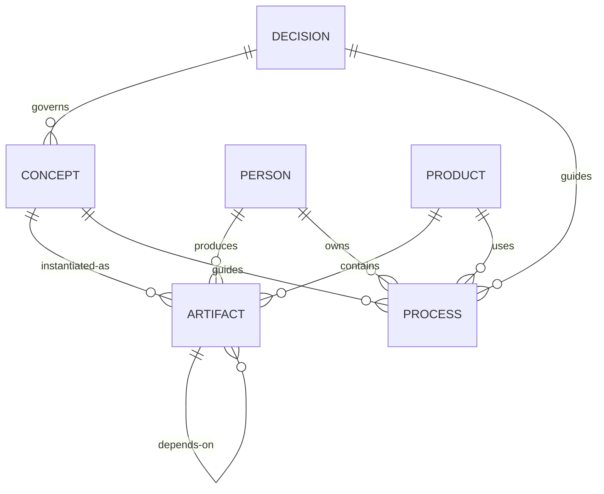

# VJSOS Knowledge Graph — Graph Schema

> Formal schema for entities, properties, and relationships (Mermaid + table).

## Entity Definitions



### Properties by Entity Type

| Entity | Required Properties | Optional Properties |
|--------|--------------------|---------------------|
| **Concept** | `id`, `name`, `definition` | `tags`, `related_concepts` |
| **Artifact** | `id`, `path`, `version`, `created` | `producer`, `tags`, `license` |
| **Person/Role** | `id`, `name`, `type` (human/agent) | `prompt_path`, `kpis`, `escalation` |
| **Decision** | `id` (ADR-XXXX), `title`, `status`, `date` | `consequences`, `alternatives` |
| **Process** | `id`, `name`, `owner`, `trigger` | `inputs`, `outputs`, `sla` |
| **Product** | `id`, `name`, `status` | `revenue_model`, `metrics` |

## Relationship Definitions

| Relation | Domain → Range | Cardinality | Constraints |
|----------|----------------|-------------|-------------|
| `depends-on` | Artifact → Artifact | Many-to-Many | Acyclic |
| `part-of` | Artifact → Product | Many-to-One | Every artifact has one product |
| `produced-by` | Artifact → Person/Role | Many-to-One | Traceable to agent/human |
| `references` | Decision → Concept | Many-to-Many | ADR must cite concepts |
| `governs` | Decision → Process | One-to-Many | One ADR can govern many processes |
| `relates-to` | Any → Any | Many-to-Many | Symmetric, informational |

## Query Patterns (Formal)

### Prerequisites of X
```cypher
MATCH (x:Artifact {id: $X})-[:depends_on*]->(preq)
RETURN preq
```

### Location of Asset Y
```cypher
MATCH (y:Artifact {id: $Y})-[:part_of]->(p:Product)
RETURN p.path
```

### Owner of Process Z
```cypher
MATCH (z:Process {id: $Z})<-[:owns]-(person:Person)
RETURN person.name, person.type
```

### Decisions Affecting Topic W
```cypher
MATCH (d:Decision)-[:references|governs]->(c:Concept {name: $W})
RETURN d.id, d.title, d.status
```

## Validation Rules

1. **No orphan artifacts:** Every artifact must have `part-of` edge.
2. **ADR completeness:** Every ADR must have `references` to ≥1 Concept.
3. **Process ownership:** Every Process must have exactly 1 `owns` edge.
4. **Versioning:** Every Artifact must have a `version` property.
5. **Acyclic depends-on:** No cycles in dependency graph.

## Implementation

- Stored as wiki-links in Markdown (`[[...]]`)
- CI validation via `.github/workflows/ci.yml` (markdown-link-check)
- Quarterly graph audit via [[metrics/QuarterlyReports]]

## Related

- [[knowledge/README]], [[knowledge/index]]
- [[governance/DocumentationRules]], [[governance/NamingConvention]]